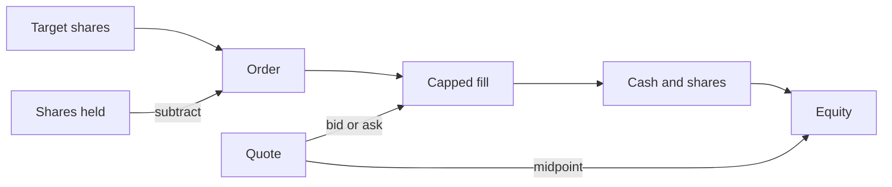

# Beyond Outliers

We are building an intraday S&P 500 portfolio to study how stock-return forecasts, risk limits and trading costs affect performance. The first runnable example follows one simulated stock through three quotes, from the opening order to the final cash balance. [Project proposal (PDF)](final_project_proposal_v2.pdf)

## Quick start

Run the example from the repository root with Python 3.12. The replay and its tests use only the standard library.

```sh
python3 Python/main.py
```

To try a different trade, edit `target_qty` (desired shares) or `max_fill_qty` (shares available to fill). Give each quote an ISO 8601 timestamp with its UTC offset and keep the rows in chronological order. [Sample quotes (CSV)](Python/sample_quotes.csv)

## From target to equity



The order is the target minus the shares held. Buys execute at the ask and sells at the bid, up to the fill cap. Any unfilled quantity expires at that quote. The next order starts from the actual position. Equity is cash plus the shares held valued at the quote midpoint.

## Sample ledger

The account opens with **$2,000 and zero shares**. Amounts are in USD. P&L and spread cost are cumulative.

| Time (ET) | Order → fill | Held | Cash | Equity | Gross P&L | Spread cost | Net P&L |
| --- | ---: | ---: | ---: | ---: | ---: | ---: | ---: |
| 09:45 | +10 → +10 | 10 | 999.80 | 1,999.80 | 0.00 | 0.20 | -0.20 |
| 10:15 | -4 → 0 | 10 | 999.80 | 2,009.80 | 10.00 | 0.20 | 9.80 |
| 10:45 | -10 → -10 | 0 | 2,000.00 | 2,000.00 | 0.50 | 0.50 | 0.00 |

At 10:15 the sell order for four shares expires unfilled, so the move to a $101 midpoint is earned on all ten shares. At 10:45 the position is flat. The $0.50 gross gain exactly covers the $0.50 spread cost, which is already reflected in the fill prices at half the quoted spread per share.

## Tests

```sh
python3 -m unittest discover -s tests
```

<details>
<summary>Research environment (optional)</summary>

For the project's notebooks and research dependencies, create a virtual environment with uv.

```sh
uv venv --python 3.12
source .venv/bin/activate
uv pip install -r requirements.txt
```

</details>
