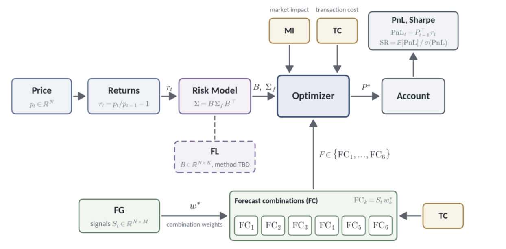

## Project Goals

We will build and backtest an end-to-end US equity portfolio, covering market data, risk and alpha models, optimization, and accounting.

- Instrument Universe: US 3000
- Market Data: Yahoo finance Security Master data and Databento intraday data
- Risk Model Construction
- Alpha Model Construction: 2-6 alpha models with a forecast horizon of 1 day
- Portfolio Construction: trading 9:30 - 4pm EST, aiming to trade every 30 minutes
- Accountant: PNL/Sharpe and position
- Moonshot Goals: Add market impact and transaction cost models in optimization

## Data Requirements

- DataBento: 1min bar data
- Yahoo Finance: supplementary security master data and cross-checks
- Other features: per alpha model request

## Team Members

Fred Chen(hc3728), Xinye Xie(xx2494), Qingyang Wang(qw2468), Jiao Xu(jx2687), Weikun Zhang(wz2559), Wen Sheng(ws2840)

{width=75%}
