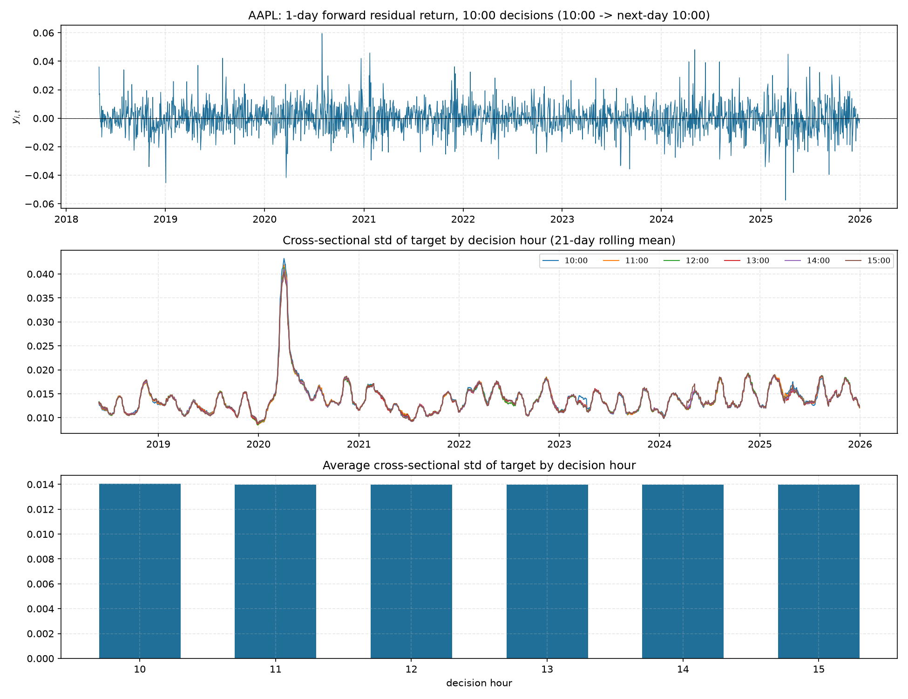

# 1. Model setting

Each team member develops a prediction model for future residual returns using information available at each decision time. Individual predictions will be combined into an ensemble signal for the portfolio optimizer. The current data pipeline provides hourly equity bars and factor-model outputs; feature selection, model class, and forecast horizon remain to be specified.

# 2. Chronological data split

Data from **2018-05-01 to 2019-05-01** are used to warm up features and the risk model. Forecast-model training starts on **2019-05-01**, and **2025** is reserved for testing.

| Sample | Decision-time interval |
|:-------|:-----------------------|
| Warm-up | 2018-05-01 $\le t <$ 2019-05-01 |
| Train | 2019-05-01 $\le t <$ 2025-01-01 |
| Test | 2025-01-01 $\le t <$ 2026-01-01 |

Dates use US/Eastern and left-closed, right-open intervals. Warm-up observations are not forecast-model training samples; testing includes available observations through **2025-12-31**.

# 3. Training, evaluation, and signal combination

- **Individual models.** Each team member develops their own prediction model within the shared training period, choosing features, model class, and hyperparameters independently.
- **Flexible validation.** Each member decides how to split training and validation data: a chronological holdout, walk-forward validation, or another time-aware approach. Model selection and tuning stay within the training period.
- **Common test evaluation.** Finalize individual models, then evaluate all predictions on the same 2025 test set using agreed metrics. Use a common target, forecast horizon, and evaluation universe; submit predictions indexed by timestamp and ticker on a consistent scale.
- **Combined signal.** After evaluating individual models, combine their predictions into an ensemble signal for portfolio optimization. The combination rule is to be agreed. Set weights using training-period validation predictions or a preset rule; if 2025 results are used to select models or tune weights, the ensemble needs a new holdout for independent evaluation.

# 4. Target

The target is the 1-trading-day forward residual return. Decisions are made at the hourly bar ends $t$ = 10:00, 11:00, ..., 15:00 (no trading at 16:00), and
$$
y_{i,t} = \sum_{k=1}^{7} u_{i,t+k},
$$
where $u_{i,s}$ is the residualized leading return of stock $i$ at bar label $s$ (open of the bar ending at $s$ to the open of the next bar) and $t+k$ is the stock's $k$-th next bar. The window runs from the price at $t$ to the price at the same time on the next trading day, e.g. the 10:00 target sums the 11:00, ..., 16:00 and next-day 10:00 bars. Windows without exactly one overnight (16:00) bar are dropped, and so are windows touching an NYSE half day (decisions on a half day and on the trading day before it). Built by `Python/forecasts/build_target.py` and saved to `data/target/1h_bar.parquet`.

{width=100%}
